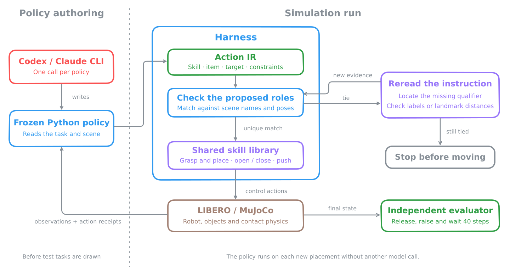

# CS6244 · 让代码智能体在仿真里做家务

给 Codex 或 Claude 一句家务指令，例如“把后方的黑碗放到盘子上”，它会写出一份可重复使用的 Python 策略。我们用 LIBERO 和 MuJoCo 执行这份策略，观察它能否找对物体、做完动作，并在机械臂松手后保持结果。项目目前全部在模拟器中运行。

我们研究的是一个具体问题：**给同一个代码智能体什么样的工具和反馈，它才能在没调过的任务上少犯错？** 本轮让程序查看原技能的下一个抓点，结合夹爪开口、上次抓取偏差和目的地空间决定是否换抓法。松手后观察到物体滑开，还能在剩余步数内补救。每组沿用一份已有策略，再调用一次模型生成代码。测试时由冻结的程序控制机械臂，重试也无需再调用模型。

## 系统如何工作



图左是生成策略的阶段，图右是执行一条新指令的过程。[透明背景 SVG 原图](docs/harness-architecture.svg)

1. **写清楚想做什么。** 策略把指令写成结构化动作（IR），声明要用的技能、操作哪个物体、放到哪个目标，以及这些角色应当满足哪些条件。
2. **动手前核对。** Harness 对照模拟器公开的实体名称、类别、区域归属和实时坐标检查提名。遇到并列时，新版回到原句，区分描述物体的词和描述目的地的词，再用标签或到参照点的距离核对。程序还可以查询每个候选能执行哪些技能。例如，固定柜顶和连接滑轨的抽屉都在上方，但只有后者能用抽屉技能拉开。若没有提出动作或提议被拦下，harness 会给出原因，允许程序最多再提两次。
3. **执行和计分。** 共享技能库负责抓取、放置、开关抽屉和短距离推压。策略能看到位移、抓起高度等动作回执。独立评测器读取任务目标，检查官方条件，并在松手、抬手、等待共 40 个控制步后再判一次。本项目报告的主指标是这次复查后的**稳定成功**。

## 最近一次测试

小烤盅进平底锅从 29/300 回到 196/300，上轮掉的 167 次全部找回。烤盅进篮子再放黄油从 71/300 到 119/300，原来的 71 次全部保住。冻结后的六道新题，旧版 321/1800，新版 323/1800，仅动作回执版 227/1800。新版多做成 71 次，也丢了 69 次。松手后有 1 次开启补救才成功，但从相同状态原地等 39 步也会成功，能归功于主动补抓的是 0 次。[逐题报告与归因](reports/grasp_preview_findings_zh.md) · [逐回合证据](reports/grasp_preview_evidence.zip)

## 此前的实验

柜顶调试中，上轮因打断原抓法丢掉的 30 个回合全部恢复。冻结后换六道新题，打断本来能成功的原动作导致的失败从 136 次降至 65 次；与此同时，更多本来可以靠换抓法做成的回合失败了。稳定成功合计从 994/1800 降到 887/1800。松手后重试在番茄酱入碗调试中有 4 次经重放证实的救回，在新题上为 0 次。[逐题报告与原因](reports/release_review_findings_zh.md) · [冻结策略和重放证据](reports/release_review_evidence.zip)

在抓取、搬运和松手时加入观测后，酒瓶调试有 340 次经重放证实的救回。迁移到原定八道新题，提前处理救回 15 次，也丢掉 34 次，稳定成功从 1349/2400 降至 1330/2400。随后用同一份冻结代码跑两道新的复合题，从 180/600 升至 193/600，其中 15 次可以归因于早点处理。十道新题的 30 次严格救回集中在七种初始摆放上，全部发生在抓取阶段。[逐题成绩、丢分原因和重放示例](reports/placement_stages_findings_zh.md) · [冻结策略和逐回合数据](reports/placement_stages_evidence.zip)

此前加入动作后反馈，在关炉调试中救回 252/300 次，逐一重放、重复原动作均失败。冻结后换六道新题，Codex 和 Claude 各跑 900 次，相对旧版均救回 0 次。放置任务中有 176 次确实发现了偏差并重试，但到重试时通常只剩几十个控制步。[动作后反馈实验与逐题成绩](reports/effect_findings_zh.md)

动作前反馈比同一份策略在旧 harness 上多完成了 146 个回合（15 个任务编号，每题 50 个摆放，每个模型三份策略）。其中 **47 次**能用同状态重放证实是从错对象改到对对象带来的新增成功；98 次是补上了原本缺失的动作，另外 1 次恢复旧提名也能完成。单看排除了同义改写和熟悉子任务的七题，两种模型的新增成功都是 **0**。完整报告给出了三种方法的分数，以及为什么开抽屉和关炉会出现不同的结果。[动作能力与重试实验](reports/affordance_findings_zh.md)

## 快速复查

从本仓库根目录运行。新机器需要 Git 和 Python 3.11。安装脚本会下载固定版本的 LIBERO 和仿真依赖。已有项目环境时，直接将 `LIBERO_PY` 指向其 Python 即可。

```bash
bash sim/setup_libero.sh
LIBERO_PY="${LIBERO_VENV:-third_party/libero-env}/bin/python"
export MUJOCO_GL=egl OPENBLAS_NUM_THREADS=1 OMP_NUM_THREADS=1 MKL_NUM_THREADS=1
"$LIBERO_PY" harness/reselection/test_recovery.py
```

想看一次真实的仿真执行，可以展开冻结策略，在每道题的一个官方初始摆放上运行评分器。这条命令使用早期 LIBERO-Long 策略，便于先确认物理环境可用。

```bash
DEMO_DIR="$(mktemp -d)"
"$LIBERO_PY" -m zipfile -e reports/simulator_evidence.zip "$DEMO_DIR"
"$LIBERO_PY" sim/libero_long.py score \
  --policy "$DEMO_DIR/runs/long_codex_01/policy_calibrated.py" --split test --limit 1
```

上一轮的动作前重选报告解释了哪些摆放得救、哪些仍被误拦，以及如何复核三组成绩。重新生成策略才需要登录两种 CLI，查看证据和重放已有策略均可离线运行（先备好环境和数据）。[实验报告](reports/reselection_findings_zh.md) · [冻结程序与逐次结果](reports/reselection_evidence.zip)

## 从哪里读起

| 想了解什么 | 入口 |
| --- | --- |
| 课程要求、项目起点，以及纯仿真的实验范围 | [课程要求](docs/project_requirement.md) · [项目背景](docs/project_intro.md) · [仿真实验指南](docs/simulator_experiments.md) |
| 机器人能看到哪些数据、调用哪些技能 | [观测与动作回执](harness/interaction/tools_api.py) · [共享技能库](harness/preflight/skill_library.py) |
| 动作如何表示、歧义怎样重新核对 | [动作 IR 示例](harness/preflight/README.md) · [重选实现](harness/reselection/recovery.py) |
| 如何排除旧题、固定新摆放、公平比较 | [抽题规则](harness/reselection/sample.py) · [配对评测程序](harness/reselection/run.py) |
| 此前在哪些地方涨过分、在哪里失败 | [抓法实验](reports/grasp_findings_zh.md) · [动作回执实验](reports/interaction_findings_zh.md) · [动作前检查实验](reports/preflight_findings_zh.md) |

模拟器向策略公开有名称的场景实体和位置。不同任务可能共享一个房间、同一类碗或同一套抓取技能；新题通过指令和初始状态去重。因此这里的成绩衡量的是有这些观测时的仿真迁移能力。[官方 LIBERO 任务和资产](https://github.com/Lifelong-Robot-Learning/LIBERO/tree/8f1084e3132a39270c3a13ebe37270a43ece2a01)
